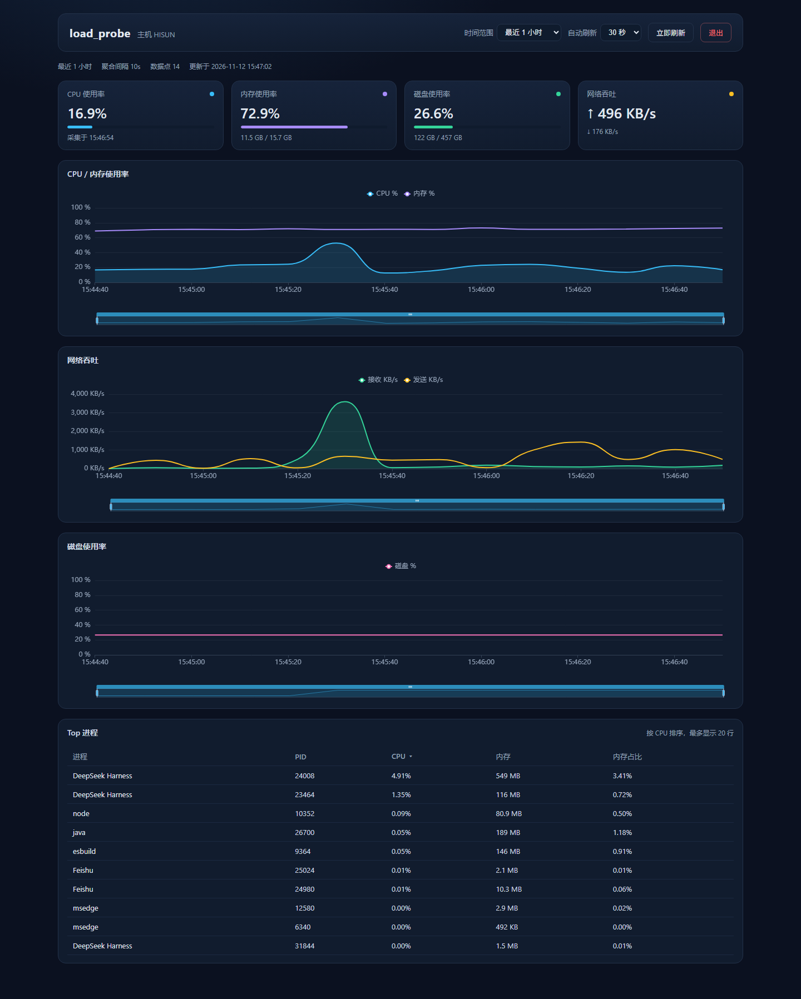

# load_probe

本机（Windows）资源指标采集服务：定时采集 **整机 CPU / 内存 / 磁盘 / 网络** 以及 **CPU Top-N 进程**，
写入 PostgreSQL，并提供带鉴权的时间跨度查询接口。

## 当前状态

- 采集 → 入库 → 查询 全链路已跑通，用 curl 验证过（采集间隔实测 10 秒）
- 数据保留 7 天，每天 03:30 由清理任务删除过期数据
- 接口鉴权：请求头 `X-API-Key`
- 前端看板已完成（`web/`，Vue 3 + Vite + ECharts），见下方「前端看板」

## 环境

| 组件 | 位置 |
| --- | --- |
| PostgreSQL 17.11（便携版） | 程序 `D:\pg\pgsql`、数据 `D:\pgdata`、日志 `D:\pg\log\postgres.log` |
| 应用数据库 | 库/用户 `load_probe`（密码见 `D:\pg\credentials.txt` 与 `config/local.env`） |
| Temurin JDK 21 | `.tools/jdk-21.0.13+9`（项目内便携版） |
| Maven 3.9.16 | `.tools/apache-maven-3.9.16` |

## 启动

> Windows 默认的执行策略是 `Restricted`，直接跑 `.ps1` 会报「因为在此系统上禁止运行脚本」。
> 因此每个脚本都配了 `.cmd` 入口（内部用 `-ExecutionPolicy Bypass` 调用同名 ps1）。
> 想直接跑 `.ps1`，可执行一次：`Set-ExecutionPolicy -Scope CurrentUser RemoteSigned`。

```powershell
# 1) 启动数据库（已运行会直接提示）
scripts\pg-start.cmd

# 2) 构建（首次需要联网下载依赖）
. .\scripts\dev-env.ps1
mvn clean package

# 3) 启动应用（读取 config/local.env 中的密码与 API Key）
scripts\run.cmd

# 可选：临时改采集间隔（最小 10 秒）
scripts\run.cmd -Interval 10
```

其他脚本：`scripts\pg-stop.ps1`、`scripts\pg-status.ps1`（同样可用 `powershell -ExecutionPolicy Bypass -File ...` 调用）。

### 启动与停止速查

| 操作 | 命令 | 说明 |
| --- | --- | --- |
| 启动数据库 | `scripts\pg-start.cmd` | 已在运行会直接提示 |
| 停止数据库 | `scripts\pg-stop.cmd` | |
| 数据库状态 | `scripts\pg-status.cmd` | |
| 启动后端 | `scripts\run.cmd` | 可加 `-Interval 10` 临时改采集周期 |
| 启动前端 | `scripts\web-dev.cmd` | 浏览器开 http://127.0.0.1:5173 |
| **停止前后端** | `scripts\stop-app.cmd` | 按端口 8080/5173 结束进程 |
| 构建前端 | `scripts\web-build.cmd` | 产物在 `web/dist` |

前端/后端在独立窗口跑时，也可以直接在那个窗口按 `Ctrl+C` 停止。
`stop-app.cmd` 额外接受端口参数：`scripts\stop-app.cmd -Ports 8080`。

## 配置

真实配置放 `config/local.env`（已被 `.gitignore` 忽略），模板见 `config/local.env.example`：

| 变量 | 默认 | 说明 |
| --- | --- | --- |
| `LOADPROBE_DB_URL` | `jdbc:postgresql://127.0.0.1:5432/load_probe` | 数据库地址 |
| `LOADPROBE_DB_USER` / `LOADPROBE_DB_PASSWORD` | `load_probe` / 空 | 数据库账号 |
| `LOADPROBE_API_KEY` | 空（不校验） | 查询接口密钥 |
| `LOADPROBE_INTERVAL_SECONDS` | 60 | 采集间隔，**最小 10**，小于 10 启动即失败并提示 |
| `LOADPROBE_TOP_N` | 10 | 每轮采集进程数 |
| `LOADPROBE_RETENTION_DAYS` | 7 | 数据保留天数 |
| `LOADPROBE_LOG_FILE` | `logs/load-probe.log` | 日志文件 |

## 查询接口

全部接口需要请求头 `X-API-Key: <密钥>`，缺失或错误返回 `401`。
**例外**：`GET /api/v1/health` 默认免鉴权（方便浏览器/探针直接看状态），
可在 `application.yml` 的 `loadprobe.auth-exempt-paths` 里调整，清空即恢复全量鉴权。

时间参数使用 ISO-8601（UTC），例如 `2026-11-12T04:00:00Z`。

### 1. 系统指标时间序列

```
GET /api/v1/metrics/system?from=<ISO>&to=<ISO>&interval=<30s|1m|5m|1h|1d>
```

- `from` 默认 `to - 1h`，`to` 默认当前时间
- `interval` 默认取采集间隔；点太多（超过 `max-points`，默认 2000）时自动放大桶
- 返回每个桶的平均值 + 样本数

```bash
curl -H "X-API-Key: $KEY" \
  "http://127.0.0.1:8080/api/v1/metrics/system?from=2026-11-12T03:00:00Z&to=2026-11-12T05:00:00Z&interval=1m"
```

### 2. 进程指标（原始行，时间倒序）

```
GET /api/v1/metrics/processes?from=<ISO>&to=<ISO>&limit=<1..5000，默认 200>
```

### 3. 最近一次采集

```
GET /api/v1/metrics/latest
```

### 4. 健康检查（免鉴权）

```
GET /api/v1/health
```

返回状态、主机名、当前采集间隔、Top-N、保留天数。浏览器可直接打开
`http://127.0.0.1:8080/api/v1/health` 验证服务是否在线。

## 前端看板（web/）

技术栈：Vue 3 + Vite + TypeScript + ECharts。



<p align="center"></p>

### 启动

```powershell
# 1) 先启动后端
scripts\run.cmd
# 2) 另开一个窗口启动前端（自动安装依赖）
scripts\web-dev.cmd
# 浏览器打开 http://127.0.0.1:5173，输入 config/local.env 里的 LOADPROBE_API_KEY
```

构建静态产物：`scripts\web-build.cmd`（输出 `web/dist`）。

开发时 Vite 把 `/api` 代理到 `http://127.0.0.1:8080`，所以不存在跨域；将来把 `web/dist`
交给 Nginx 或直接放进后端 `static/`，同样是同源部署。

### 鉴权（方案 A）

- 首次进入要求输入 API Key，存在 `sessionStorage`（关闭标签页即失效）
- 所有请求由 `src/api/client.ts` 统一加 `X-API-Key` 头
- 收到 401 时清空 Key 并回到登录页

> 这只是演示方案：Key 在浏览器里可被读到。正式对外时建议加 `POST /api/v1/auth/login`
> 换短期 JWT 并用 HttpOnly Cookie 承载，前端代码不再持有密钥。

### 功能

| 区块 | 说明 |
| --- | --- |
| 顶栏 | 时间范围（15 分钟 / 1 小时 / 6 小时 / 24 小时 / 7 天）、自动刷新（关闭 / 10 / 30 / 60 秒）、手动刷新、退出 |
| KPI 卡片 | CPU、内存（已用/总量）、磁盘（已用/总量）、网络上下行速率 |
| 三张趋势图 | CPU+内存、网络吞吐（KB/s）、磁盘使用率，带缩放条（dataZoom） |
| Top 进程表 | 默认按 CPU 排序，可切内存/内存占比，最多 20 行 |

时间跨度到聚合间隔的换算在 `src/utils/interval.ts`：按「跨度 ÷ 400 点」挑一个间隔，
后端还会再做一次兜底放大。

## 数据模型

`system_metrics`（每轮一行）：

| 字段 | 说明 |
| --- | --- |
| `collected_at` | 采集时刻（`timestamptz`，UTC） |
| `host` | 机器标识 |
| `cpu_usage_pct` | 整机 CPU 使用率 % |
| `mem_total_bytes` / `mem_used_bytes` / `mem_usage_pct` | 内存 |
| `disk_total_bytes` / `disk_used_bytes` / `disk_usage_pct` | 磁盘（所有文件系统汇总） |
| `net_rx_bytes_per_sec` / `net_tx_bytes_per_sec` | 两次采样间的平均网络吞吐 |

`process_metrics`（每轮 Top-N 行）：`collected_at`、`host`、`pid`、`process_name`、
`cpu_usage_pct`（归一化为整机占比，排除 Idle 进程）、`mem_rss_bytes`、`mem_usage_pct`。

表结构由 Flyway 管理：`src/main/resources/db/migration/`。

## 日志

| 日志 | 位置 |
| --- | --- |
| 应用日志 | `logs/load-probe.log`（按 10MB 滚动，保留 7 个文件 / 总计 200MB） |
| PostgreSQL 日志 | `D:\pg\log\postgres.log` |

每轮采集会打一行 INFO（采集耗时、CPU、内存、磁盘、网络、进程数），
DEBUG 级别会额外打印 Top 3 进程明细（`com.example.loadprobe` 默认 DEBUG）。

## 已知环境问题（已绕过）

1. 本机 `C:\Users\<用户>\AppData\Local\Temp` 与 `~/.m2` 写入被文件权限拒绝 →
   Tomcat 临时目录改到项目 `work/tomcat`、JVM 临时目录改到 `.tmp`、Maven 本地仓库改到 `.tools/m2repo`。
2. 沙箱/受限终端下 WMI 性能计数器不可用 → 采集程序需在普通终端运行（本项目的 `run.ps1` 即可）。
3. 进程级 CPU 用两次采样的 ticks 差值计算，第一轮样本为累计值，属于正常现象。

## 后续可做

- 前端看板（建议同仓库 `web/`，Vue 3 + Vite + ECharts）
- 注册为 Windows 服务（WinSW）实现 7×24 常驻
- 多机器采集（表里已预留 `host` 字段）
